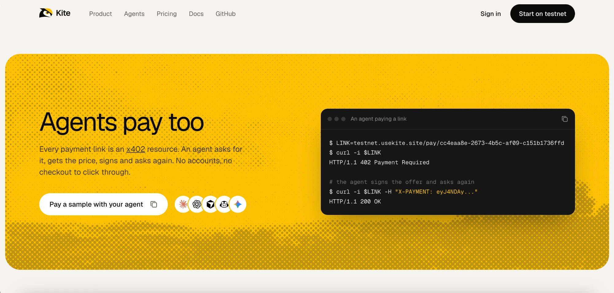
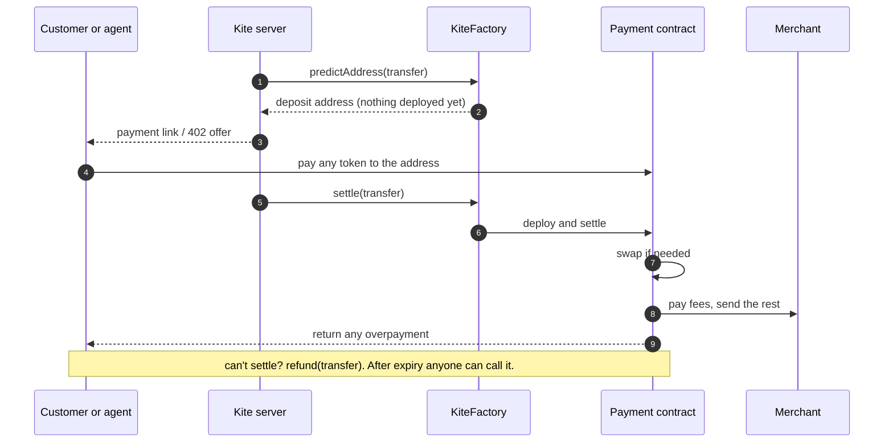
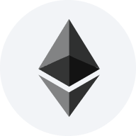
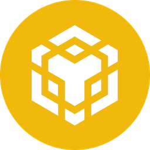
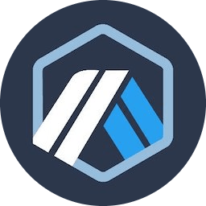
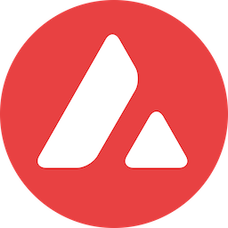
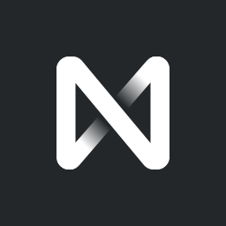
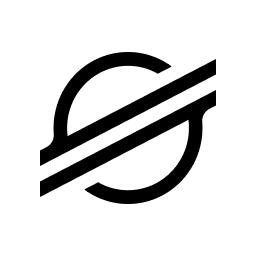

<a href="https://usekite.tech"></a>

<div align="center">

### Open-source crypto payments that people and AI agents can both pay.

[](https://usekite.tech)
[](https://testnet.usekite.tech)
[](https://docs.usekite.tech)
[](https://www.x402.org)
[](https://usekite.tech/sponsor)

</div>

Kite is a crypto payment processor a business runs itself. The business creates a payment link, the customer pays it in any token on any of the business's chains, a Kite contract settles the payment on-chain, and a signed webhook tells the business's systems.

- **A person** opens the link and sees a normal checkout: connect a wallet, or send tokens to an address shown as a QR code.
- **An AI agent** requests the same link and gets an HTTP `402 Payment Required` [x402](https://www.x402.org) resource. It pays with a signed HTTP request and no browser. Kite is its own facilitator and pays the gas, except on Gno.land, which has no fee sponsorship.
- **Any token in, one token out.** Payments are swapped on-chain, and with [NEAR Intents](https://docs.near-intents.org/) every payment can be delivered as one token at one address, whichever chain the customer paid on.

<details>
<summary><b>🤖 Pay a sample link with your agent</b></summary>

<br />

```sh
LINK=https://testnet.usekite.tech/pay/cc4eaa8e-2673-4b5c-af09-c151b1736ffd

# 1. ask for the link: Kite answers 402 with an x402 offer per network
curl -i -H "Accept: application/json" $LINK

# 2. the agent signs one offer and asks again
curl -i $LINK -H "PAYMENT-SIGNATURE: <signed payload>"
# HTTP/1.1 200 OK, with the settlement in the PAYMENT-RESPONSE header
```

Any x402 v2 client does both steps for you.

| Network | Price      | Link                                                                    |
| ------- | ---------- | ----------------------------------------------------------------------- |
| Testnet | 1 USD      | <https://testnet.usekite.tech/pay/cc4eaa8e-2673-4b5c-af09-c151b1736ffd> |
| Testnet | 1 GBP      | <https://testnet.usekite.tech/pay/6c103330-4adc-43a1-9335-084027a3f284> |
| Mainnet | 1 USD      | <https://mainnet.usekite.tech/pay/a1b264be-d168-42a9-9a2e-d2b0b0aa0467> |
| Mainnet | 10,000 NGN | <https://mainnet.usekite.tech/pay/b42601ba-9cb7-4b94-a2c0-4382526f6bc3> |

</details>

## One contract per payment

Each payment gets its own contract, at an address known before anyone pays. Kite never holds the money: the contract receives the customer's tokens, then settles or refunds them on-chain.



<details>
<summary><b>📜 How the contracts keep funds safe</b></summary>

<br />

- **Predict.** The factory derives the deposit address from the payment's terms: merchant, token, minimum, fees, refund address and expiry. On NEAR it's an account, and on Gno.land a sub-realm address of the Kite realm.
- **Settle.** The operator deploys the contract and settles: swap if needed (Uniswap V3 or V2 on EVM chains, Rhea on NEAR, Soroswap on Stellar, GnoSwap on Gno.land), pay each fee, send the rest to the merchant and return any overpayment.
- **Refund.** Before expiry only the operator can refund. After expiry _anyone_ can, on every chain, so a customer is never stuck waiting on a server.
- **Recover.** Tokens sent after settlement, or a refund the refund address couldn't accept, stay recoverable by the operator.
- **Upgrades can't touch live payments.** Each payment is bound to the contract code it was created with, so no upgrade can change the code of a payment that already holds funds.

</details>

## Repositories

| Repository                                                        | What it is                                                                                                                                                 | Stack                                    |
| ----------------------------------------------------------------- | ---------------------------------------------------------------------------------------------------------------------------------------------------------- | ---------------------------------------- |
| [server](https://github.com/Kite-01/server)                       | The API, the merchant dashboard, the checkout page and the x402 facilitator                                                                                | TypeScript, Bun, Elysia, React, Postgres |
| [contracts](https://github.com/Kite-01/contracts)                 | `KiteFactory` and `Kite` for EVM chains: predictable deposit addresses, Uniswap V2/V3 swaps, fees, refunds and recovery. Published as `@kite-01/contracts` | Solidity, Hardhat                        |
| [near-contracts](https://github.com/Kite-01/near-contracts)       | The same model on NEAR: a deposit account per payment, swaps through Rhea Finance                                                                          | Rust, near-sdk                           |
| [stellar-contracts](https://github.com/Kite-01/stellar-contracts) | The same model on Stellar: a Soroban contract per payment, swaps through Soroswap                                                                          | Rust, soroban-sdk                        |
| [gno-contracts](https://github.com/Kite-01/gno-contracts)         | The same model on Gno.land: a sub-realm address per payment, swaps through GnoSwap                                                                         | Gno                                      |
| [monorepo](https://github.com/Kite-01/monorepo)                   | [`@kite-01/sdk`](https://github.com/Kite-01/monorepo/tree/main/packages/sdk): create payment links, sign API requests and verify webhooks                  | TypeScript                               |
| [docs](https://github.com/Kite-01/docs)                           | The documentation at [docs.usekite.tech](https://docs.usekite.tech)                                                                                        | Fern, MDX                                |

## Supported networks

<p align="center">
  <a href="https://ethereum.org"></a>
  <a href="https://optimism.io"></a>
  <a href="https://www.bnbchain.org"></a>
  <a href="https://polygon.technology"></a>
  <a href="https://base.org"></a>
  <a href="https://arbitrum.io"></a>
  <a href="https://www.avax.network"></a>
  <a href="https://www.monad.xyz"></a>
  <a href="https://www.unichain.org"></a>
  <a href="https://zora.co"></a>
  <br />
  <a href="https://robinhood.com"></a>
  <a href="https://www.arc.network"></a>
  <a href="https://aurora.dev"></a>
  <a href="https://near.org"></a>
  <a href="https://stellar.org"></a>
  <a href="https://gno.land"></a>
  <a href="https://hsk.xyz"></a>
  <a href="https://qday.io"></a>
</p>

<details>
<summary><b>⛓️ Chains and testnets</b></summary>

<br />

| Chain           | Mainnet |      Testnet       |
| --------------- | :-----: | :----------------: |
| Ethereum        |   ✅    |      Sepolia       |
| OP Mainnet      |   ✅    |     OP Sepolia     |
| BNB Smart Chain |   ✅    |    BNB Testnet     |
| Polygon         |   ✅    |        Amoy        |
| Base            |   ✅    |    Base Sepolia    |
| Arbitrum One    |   ✅    |  Arbitrum Sepolia  |
| Avalanche       |   ✅    |        Fuji        |
| Monad           |   ✅    |   Monad Testnet    |
| Unichain        |   ✅    |  Unichain Sepolia  |
| Zora            |   ✅    |    Zora Sepolia    |
| Robinhood Chain |   ✅    | Robinhood Testnet  |
| Arc             |   ✅    |    Arc Testnet     |
| Aurora          |   ✅    |   Aurora Testnet   |
| NEAR (beta)     |   ✅    |    NEAR Testnet    |
| Stellar (beta)  |    —    |  Stellar Testnet   |
| Gno.land (beta) |    —    |    Onyx Testnet    |
| HashKey Chain   |    —    |  HashKey Testnet   |
| QDay Aevum      |    —    | QDay Aevum Testnet |

What each provider (deposit notifiers, gas sponsors, swaps, NEAR Intents) supports on each chain is in [`registry.ts`](https://github.com/Kite-01/server/blob/main/src/shared/chains/registry.ts).

</details>

## Get started

- **Try it:** open a payment link above, or point your x402 agent at one.
- **Run your own:** follow the [docs](https://docs.usekite.tech) or [Getting started](https://github.com/Kite-01/server#getting-started), then [deploy your own factory](https://github.com/Kite-01/contracts#deploying) on each chain you'll accept.
- **Integrate:** create payment links from your backend with `@kite-01/sdk` and fulfil orders from signed webhooks.

## Security

Kite's contracts hold and move funds. If you find a vulnerability, please don't open a public issue: email [security@usekite.site](mailto:security@usekite.site) instead.

## License

The contracts and SDK are MIT. The server is AGPL-3.0.
